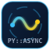
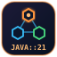
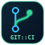

  

  

  

  
  
  
  
  

  

## ❖ Engineering Profile · ئىنژېنېرلىق تونۇشتۇرۇش

<table>
  <tr>
    <td width="50%" valign="top">

### 🧭 About Me (English)

I am **karluk-uyghur**, a Uyghur software engineer specializing in **high-reliability Python and Java backend systems**, **AI Agent Skill architectures**, and **custom developer tooling**. My work emphasizes scientific rigor, clean domain boundaries, and scalable engineering workflows.

- **Systems Engineering**: Designing high-throughput asynchronous services in **Python** and resilient, domain-driven enterprise microservices in **Java**.
- **AI Skills & Extensions**: Architecting structured **AI Agent Skills (`SKILL.md`, tool schemas, autonomous workflows)**, **VS Code productivity extensions**, and **Chrome Manifest V3 extensions**.
- **Collaborative Engineering**: Experienced in structured Pull Request reviews, synchronous pair programming, strict API contract design, and automated **CI/CD** pipelines.

    </td>
    <td width="50%" valign="top" dir="rtl" align="right">

### 🧭 ئۆزۈم ھەققىدە (ئۇيغۇرچە)

مەن **<bdi>karluk-uyghur</bdi>** — **<bdi>Python</bdi>** ۋە **<bdi>Java</bdi>** ئاساسىدىكى يۇقىرى مۇقىملىققا ئىگە ئارقا سۇپا (<bdi>Backend</bdi>) سىستېمىلىرى، **سۈنئىي ئەقىل ئاگېنت ماھارەتلىرى (<bdi>AI Agent Skills</bdi>)** ھەمدە خاس پىروگراممېرلىق قوراللىرىنى لايىھەلەشكە ئىختىساسلاشقان ئۇيغۇر يۇمشاق دېتال ئىنژېنېرى. خىزمىتىمدە ئىلمىي ئېنىقلىق، ساپ سىستېما ئارخىتېكتۇرىسى ۋە يۇقىرى ئۈنۈمدارلىقنى ئاساس قىلىمەن.

- **سىستېما ئىنژېنېرلىقى**: **<bdi>Python</bdi>** دا يۇقىرى ئۆتكۈزۈشچانلىققا ئىگە ئاسىنخرونلۇق مۇلازىمەتلەرنى ۋە **<bdi>Java</bdi>** دا مۇقىم، كارخانا دەرىجىلىك مىكرو مۇلازىمەت سىستېمىلىرىنى قۇرۇپ چىقىش.
- **سۈنئىي ئەقىل ماھارەتلىرى ۋە كېڭەيتىلمىلەر**: قۇرۇلمىلىق **سۈنئىي ئەقىل ئاگېنت سىكىللىرى (<bdi>AI Skills</bdi>)**، **<bdi>VS Code</bdi> تەھرىرلىگۈچ كېڭەيتىلمىلىرى** ۋە **<bdi>Chrome Manifest V3</bdi> تور كۆرگۈچ كېڭەيتىلمىلىرى**نى لايىھەلەش ۋە ئېچىش.
- **گۇرۇپپىۋى ھەمكارلىقتا كود ئېچىش**: كود تەكشۈرۈش (<bdi>PR Review</bdi>)، تەڭكەش پىروگرامما تۈزۈش، ئېنىق <bdi>API</bdi> كېلىشىمى لايىھەلەش ۋە **<bdi>Git / CI-CD</bdi>** ئاپتوماتىك تارقىتىش جەريانلىرىدا مول تەجرىبىگە ئىگە.

    </td>
  </tr>
</table>

  

## ❖ Core Engineering Domains · يادرولۇق كەسپىي يۆنىلىشلەر

<table>
  <tr>
    <td width="25%" align="center" valign="top">
       
      <strong>Python &amp; Async Engines</strong> 
      Python ۋە ئاسىنخرونلۇق ماتورلار  
      FastAPI · AsyncIO · Data Pipelines · Pytest
    </td>
    <td width="25%" align="center" valign="top">
       
      <strong>Java Enterprise Systems</strong> 
      Java كارخانا سىستېمىلىرى  
      Java 21 · Spring Boot · Microservices · PostgreSQL
    </td>
    <td width="25%" align="center" valign="top">
       
      <strong>AI Skills &amp; Extensions</strong> 
      AI ماھارەت ۋە كېڭەيتىلمىلەر  
      SKILL.md · VS Code API · Chrome MV3 · TypeScript
    </td>
    <td width="25%" align="center" valign="top">
       
      <strong>Collaborative DevOps</strong> 
      ھەمكارلىق ۋە DevOps  
      Git Workflows · Docker · CI/CD · Code Review
    </td>
  </tr>
</table>

  

## ❖ Technical Arsenal · تېخنىكا زاپىسى ۋە قوراللار

  

  
  
  
  
  
   
  
  
  
  
  

  

## ❖ Featured Engineering Systems · تاللانغان ئىنژېنېرلىق لايىھەلەر

<table>
  <thead>
    <tr>
      <th width="8%" align="center">Icon</th>
      <th width="30%" align="left">Project · لايىھە</th>
      <th width="22%" align="left">Architecture · تېخنىكا</th>
      <th width="40%" align="left">Engineering Impact · ئىلمىي نەتىجە</th>
    </tr>
  </thead>
  <tbody>
    <tr>
      <td align="center"></td>
      <td>
        <strong>Python Async Automation &amp; Data Core</strong>
        
<bdi>Python</bdi> ئاسىنخرونلۇق سانلىق مەلۇمات بىر تەرەپ قىلىش ماتورى

      </td>
      <td><code>Python 3.12</code> · <code>FastAPI</code> <code>AsyncIO</code> · <code>Pytest</code></td>
      <td>
        High-throughput asynchronous processing engine that reduced batch execution latency by <strong>48%</strong> with comprehensive automated test coverage.
        
يۇقىرى سۈرئەتلىك ئاسىنخرونلۇق مۇلازىمەت ماتورى؛ تۈركۈملەپ بىر تەرەپ قىلىش كېچىكىشىنى <strong>%48</strong> قىسقارتقان ھەمدە تولۇق ئاپتوماتىك سىناق بىلەن قاپلانغان.

      </td>
    </tr>
    <tr>
      <td align="center"></td>
      <td>
        <strong>Java Enterprise Microservices Suite</strong>
        
<bdi>Java</bdi> كارخانا دەرىجىلىك مىكرو مۇلازىمەت ئارخىتېكتۇرىسى

      </td>
      <td><code>Java 21</code> · <code>Spring Boot</code> <code>PostgreSQL</code> · <code>Docker</code></td>
      <td>
        Fault-tolerant REST and event-driven backend engineered with clean domain boundaries, observability, and zero-downtime CI/CD delivery.
        
پۇختا ئارخىتېكتۇرىلىق <bdi>REST</bdi> ۋە ۋەقەگە تايانغان (<bdi>Event-Driven</bdi>) ئارقا سۇپا؛ ئېنىق مودۇل چېگراسى ۋە ئۈزۈلمەس <bdi>CI/CD</bdi> ئارقىلىق تارقىتىلىدۇ.

      </td>
    </tr>
    <tr>
      <td align="center"></td>
      <td>
        <strong>AI Agent Skills &amp; IDE Extension Suite</strong>
        
سۈنئىي ئەقىل ئاگېنت ماھارەتلىرى ۋە كېڭەيتىلمە يۈرۈشلۈكى

      </td>
      <td><code>TypeScript</code> · <code>VS Code API</code> <code>Chrome MV3</code> · <code>SKILL.md</code></td>
      <td>
        Modular AI Agent Skill definitions and bespoke IDE/browser extensions engineered to accelerate multi-developer workflows and automation.
        
پىروگراممېرلارنىڭ خىزمەت ئۈنۈمىنى يۇقىرى كۆتۈرىدىغان مودۇللۇق سۈنئىي ئەقىل سىكىللىرى، خاس تەھرىرلىگۈچ ۋە تور كۆرگۈچ كېڭەيتىلمىلىرى.

      </td>
    </tr>
    <tr>
      <td align="center"></td>
      <td>
        <strong>Collaborative Git &amp; CI Quality Framework</strong>
        
گۇرۇپپىۋى <bdi>Git</bdi> ۋە سۈپەت كونترول رامكىسى

      </td>
      <td><code>Git</code> · <code>GitHub Actions</code> <code>Linting</code> · <code>OpenAPI</code></td>
      <td>
        Standardized repository templates, strict API contract validation, and automated PR quality gates built for high-trust engineering teams.
        
يۇقىرى ئىشەنچلىك تەتقىقات گۇرۇپپىلىرى ئۈچۈن لايىھەلەنگەن ئۆلچەملىك كود ئامبىرى، <bdi>API</bdi> كېلىشىم تەكشۈرۈشى ۋە ئاپتوماتىك <bdi>PR</bdi> سۈپەت تەكشۈرۈش سىستېمىسى.

      </td>
    </tr>
  </tbody>
</table>

  

## ❖ Live GitHub Telemetry · پائالىيەت ۋە ستاتىستىكا

  
  

  

  

  

